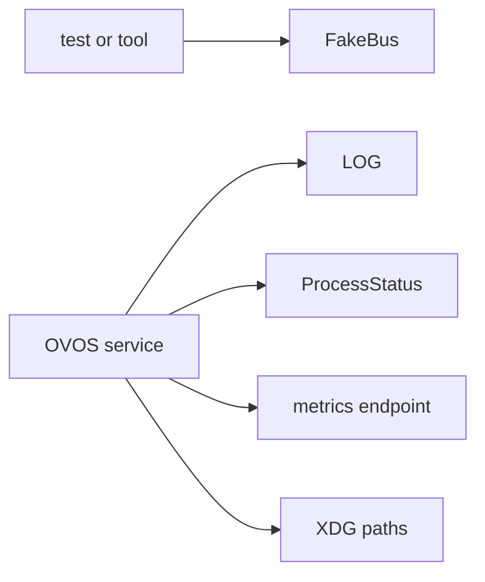

# ovos-utils documentation
<!-- agent-hint
covers: the reading order of the ovos-utils docs
source: docs/*.md
generated: no
verify: python3 docs/check_page.py docs/index.md && for f in $(grep -o '([a-z-]*\.md)' docs/index.md | tr -d '()' | sort -u); do test -f docs/$f || exit 1; done
see: modules.md
-->

`ovos-utils` gives the shared helpers that every OpenVoiceOS service uses: logging, process status, a fake bus for tests, events, files, network and XDG paths.



## Quickstart

```bash
uv pip install --prerelease=allow ovos-utils
```

```python
from ovos_utils.fakebus import FakeBus, FakeMessage

bus = FakeBus()
bus.on("recognizer_loop:utterance", lambda m: print(m.data["utterances"]))
bus.emit(FakeMessage("recognizer_loop:utterance", {"utterances": ["hello"]}))
```

```text
['hello']
```

## Pages

| Page | What you get there |
| :--- | :--- |
| [modules.md](modules.md) | Each module, what it holds, and the environment variables |
| [fakebus.md](fakebus.md) | How to test bus code with `FakeBus` and `AsyncFakeBus` |
| [events.md](events.md) | `EventContainer`, the event scheduler interface and handler wrappers |
| [log.md](log.md) | How to log with `LOG` and mark a function as deprecated |
| [ovos-logs.md](ovos-logs.md) | How to slice, list and shrink service logs |
| [process-utils.md](process-utils.md) | `ProcessStatus`, `RuntimeRequirements` and `PIDLock` |
| [utilities.md](utilities.md) | File, network, sound, thread and XDG helpers |
| [metrics.md](metrics.md) | How to time code and turn on the metrics endpoint |
| [prerelease-quirks.md](prerelease-quirks.md) | What differs from the last stable release |
